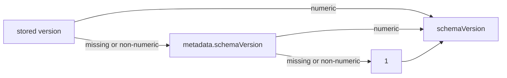

# Numeric message schema version

## Problem Statement

Emmett users evolve message schemas over time. They need to know which version of a message they read, so an upcaster can turn an old shape into the current one. Today the schema version is an optional string inside message metadata (`metadata.schemaVersion`, default `'1'`). That makes things unclear:

- A string cannot discriminate a TypeScript union. `ProductItemAddedV1 | ProductItemAddedV2` cannot be narrowed by a `switch` on the version, so upcasters need casts.
- The version is mixed with user metadata, although it describes the message shape, the same way `kind` does.
- It is supported only by PostgreSQL and SQLite. MongoDB, EventStoreDB and the in-memory store ignore it.
- The `message_schema_version` column in PostgreSQL and SQLite is `TEXT` and holds junk in rows written before 0.43.0. PostgreSQL stored `'"1"'` (with quotes) for every row. SQLite stored the stream's expected version (`0`, `1`, `2`, ...), which looks like a valid number.

The string type was introduced only in the 0.43.0 release candidates, but some teams already run 0.43.0 in production, mostly on PostgreSQL. Their stored data must keep reading correctly. Their code may break, as long as the upgrade is explained.

The goal is a numeric, top-level `schemaVersion` on every message, stored and returned by all five event stores, without losing or misreading old data, and with a path for existing stores to move to a numeric column.

The projection definition version is already a `number` in the API and an integer in storage. It stays as it is.

## Solution

### Messages carry a numeric schema version

`schemaVersion` moves out of metadata and sits next to `kind` on `Message`, `Event` and `Command`. The numeric literal is given as the last type parameter, so versions of the same message form a discriminated union. On a type declared without a version (or with version `1`), `schemaVersion` is optional. On a type declared with another version, it is required, so V2 data can never be stored as version `1` by mistake:

```ts
type ProductItemAddedV1 = Event<'ProductItemAdded', { productId: string }>;
type ProductItemAddedV2 = Event<'ProductItemAdded', { productItem: ProductItem }, undefined, 2>;
```

A message without a version is version `1`. On recorded messages (what the event store returns), `schemaVersion` is a required `number`.

The `event()`, `command()` and `message()` helpers take the version as their last argument. The argument is required when the type declares a version, and absent when it does not:

```ts
event<ProductItemAddedV2>('ProductItemAdded', { productItem }, 2);
```

### Every store stores and returns it

All five stores persist `schemaVersion` on append and return it on read. Where it is stored depends on what the database offers:

- PostgreSQL and SQLite: the `message_schema_version` column.
- MongoDB and the in-memory store: a top-level field on the stored message, next to `type`, `data` and `metadata`.
- EventStoreDB: events have only `type`, `data` and `metadata`, so the version is stored in the event metadata as `schemaVersion`.

When a read finds no usable stored value, it falls back the same way in every store:



SQLite is the exception: after its mandatory migration the column always holds a number, so it reads the column only.

After the version is resolved, every read removes `schemaVersion` from `metadata`. A recorded message shows only the top-level number, also for old events whose stored metadata still contains the old string.

### Blue/green upgrades on PostgreSQL

Teams running PostgreSQL in production may upgrade blue/green or rolling, with 0.43.0 instances and new instances sharing one store. A 0.43.0 reader takes the version only from `metadata.schemaVersion`. So, for now, PostgreSQL appends also write the version as a string (`'2'`) into the stored metadata. This copy is temporary and will go in a later release. Old instances writing to an upgraded store keep working too: their string metadata is read through the fallback above, and their append function keeps working on both column types.

No other store writes this copy. SQLite requires its migration and does not support blue/green. MongoDB, EventStoreDB and the in-memory store had no schema version support in 0.43.0, so there is no 0.43.0 reader to stay compatible with.

The prepared 0.44.0 migrations (see Release) drop the old append function, so from 0.44.0 on, 0.43.0 instances can still read during blue/green but can no longer append. 0.44.0 supports blue/green with 0.43.0 instances only, not with 0.42.x.

### Upcasting and downcasting

`upcast` and `downcast` can change the version. If the function returns a `schemaVersion`, it replaces the original, the same way `data` does. If it returns none, the original stays.

### PostgreSQL: new stores and existing stores

New PostgreSQL stores get `message_schema_version` as an `INT` column, placed for alignment ("column tetris") after the 8-byte columns and before the 1-byte ones.

Existing stores keep their `TEXT` column after the automatic migrations of the current release. Reads and appends support both column types. On a `TEXT` column, junk such as `'"1"'` is non-numeric, so the read falls back to metadata and then to `1`.

Appends go through a database function. 0.43.0 instances call the existing function with versions as strings, and cannot be changed. An overload with the same name would make their calls ambiguous in PostgreSQL. So the current release adds a separately named append function, `emt_append_to_stream_v_0_43_0`, that takes numbers, and new code calls it with explicit casts. The existing function stays for 0.43.0 callers. The automatic migration rewrites its body so it converts the strings it gets to fit the column: unchanged on a `TEXT` column, numbers on an `INT` column, with `1` for non-numeric values.

Changing an existing column rewrites the whole table and locks it, so in the current release this is not automatic. Emmett provides two on-demand migrations. They are not part of the automatic migration list. Users call them wherever they want, like the projection rebuild, and pass the same migration options as for any other migrate call (for example a dry run or a timeout):

1. **Schema version migration** (`migrateSchemaToNumericMessageSchemaVersion`). It alters the column type in place to `INT`. The column stays in its position. The table is locked for reads and writes while it runs. Users are expected to run it before upgrading to 0.44.0, where it becomes mandatory.
2. **Tetris migration** (`migrateToOptimisedPostgreSQLStorageLayout`). It rebuilds the messages table into the layout of a fresh install, and runs the schema version conversion as part of the copy. Reads continue during the copy, appends wait. No data can be lost. It stays optional, also in 0.44.0.

Both migrations compute each row's new value the same way. The user can pass their own SQL `CASE` fragment to map values such as `'v2'`. It is evaluated first and can see the whole row. Rows it does not match fall back to the defaults:

```sql
COALESCE(<user case>, <numeric column value>, <numeric metadata.schemaVersion>, 1)
```

### SQLite: mandatory migration

SQLite cannot change a column type in place, and column order does not matter there. An automatic migration in the current release rebuilds the messages table with an `INT` column. Each row gets its numeric `metadata.schemaVersion`, or `1`. The old column value is never used, because it is either junk (0.42.x) or a copy of `metadata.schemaVersion ?? '1'` (0.43.0). The stored metadata of old events is left as it is.

### Release

The work is split in two:

- **Ships now, in the current 0.43.0 line.** The numeric top-level `schemaVersion` in all stores, the new PostgreSQL append function and the converting old one, reads handling both `TEXT` and `INT` columns, the PostgreSQL metadata copy, the SQLite rebuild, the new `CREATE TABLE` layout, and both on-demand PostgreSQL migrations. The new automatic migrations join the existing 0.43.0 migration sets of each driver.
- **Prepared for 0.44.0 and left unplugged.** Two separate migrations in the PostgreSQL 0.44.0 set, next to the existing checkpoint cleanup: the schema version migration made mandatory (the same migration as the on-demand one, with the user `CASE` taken from the migration options), and the drop of the old `emt_append_to_stream`. Each has a comment saying to double-check it before the 0.44.0 release. The 0.44.0 set stays out of the automatic list until that release, so either migration can still be changed or moved to 0.45.0.

## Acceptance criteria

Message types and helpers

1. Developer declares several versions of the same message as a union, so that an upcaster can narrow them by `schemaVersion` without casts.
   1.1. GIVEN `V1 = Event<'ProductItemAdded', D1>` and `V2 = Event<'ProductItemAdded', D2, undefined, 2>` WHEN an upcaster switches on `event.schemaVersion` THEN the `case 2` branch sees `data` typed as `D2`.
   1.2. GIVEN `V1` declared without a version WHEN a value of `V1` has no `schemaVersion` THEN it type-checks.
   1.3. GIVEN a command type declared with version `3` WHEN it is used in a union with its unversioned form THEN it narrows the same way as events.
   1.4. GIVEN `V1` and `V2` from 1.1 WHEN an upcaster switches on `event.schemaVersion` THEN the `default` branch sees `data` typed as `D1`.
   1.5. GIVEN `V2` declared with version `2` WHEN a value of `V2` is written without `schemaVersion` THEN it does not compile.
   1.6. GIVEN a generic function constrained by `T extends Event`, `T extends Command` or `T extends Message` WHEN it is called with `V1`, `V2` or `V1 | V2` THEN it compiles.
2. Developer creates a versioned message with a helper, so that the stored version matches the declared type.
   2.1. GIVEN an event type with version `2` and no metadata WHEN `event<T>(type, data)` is called without the version THEN it does not compile.
   2.2. GIVEN an event type with version `2` and no metadata WHEN `event<T>(type, data, 2)` is called THEN the result has `schemaVersion: 2` and `kind: 'Event'`.
   2.3. GIVEN an event type with version `2` and metadata WHEN `event<T>(type, data, metadata, 2)` is called THEN the result has `metadata` and `schemaVersion: 2`.
   2.4. GIVEN an event type without a version WHEN `event<T>(type, data)` is called THEN the result has no `schemaVersion`.
   2.5. GIVEN a command type with version `2` WHEN `command<T>(type, data, 2)` is called THEN the result has `schemaVersion: 2` and `kind: 'Command'`.
   2.6. GIVEN a message type with version `2` WHEN `message<T>(kind, type, data, 2)` is called THEN the result has `schemaVersion: 2`.
3. Developer reads a recorded message, so that the version is always known.
   3.1. GIVEN any recorded message type WHEN its `schemaVersion` is accessed THEN its type is `number`, not optional.
   3.2. GIVEN recorded message metadata types WHEN `metadata.schemaVersion` is accessed THEN it is not part of the Emmett metadata type.

Append and read, for each store (PostgreSQL, SQLite, MongoDB, EventStoreDB, in-memory)

4. User appends a message with a schema version, so that it reads back with the same version.
   4.1. GIVEN an empty stream WHEN an event with `schemaVersion: 2` is appended and the stream is read THEN the recorded event has `schemaVersion: 2`.
   4.2. GIVEN an empty stream WHEN events with versions `1`, `2` and `3` are appended in one call THEN each recorded event has its own version, in order.
   4.3. GIVEN an empty stream WHEN an event without `schemaVersion` is appended THEN the recorded event has `schemaVersion: 1`.
   4.4. GIVEN an appended event with `schemaVersion: 2` WHEN a consumer receives it THEN the message has `schemaVersion: 2`.
   4.5. GIVEN an appended event with `schemaVersion: 2` WHEN the stream is aggregated THEN `evolve` receives the event with `schemaVersion: 2`.
   4.6. GIVEN an appended command with `schemaVersion: 2` WHEN it is read THEN the recorded command has `schemaVersion: 2`.
5. User reads a recorded message, so that `metadata` holds only metadata.
   5.1. GIVEN an event appended with `schemaVersion: 2` and user metadata WHEN it is read THEN `metadata` contains the user metadata and Emmett's recorded fields, and no `schemaVersion`.
   5.2. GIVEN PostgreSQL AND an event appended with `schemaVersion: 2` WHEN the raw stored metadata is inspected THEN it contains `schemaVersion: '2'` as a string.
   5.3. GIVEN SQLite or MongoDB AND an event appended with `schemaVersion: 2` WHEN the raw stored metadata is inspected THEN it has no `schemaVersion`.
   5.4. GIVEN EventStoreDB AND an event appended with `schemaVersion: 2` WHEN the raw event metadata is inspected THEN it contains `schemaVersion` with the version.
6. User reads data that has no usable stored version (PostgreSQL, MongoDB, EventStoreDB, in-memory), so that it reads correctly.
   6.1. GIVEN a stored message without a stored version and with `metadata.schemaVersion: '2'` WHEN it is read THEN `schemaVersion` is `2` and `metadata` has no `schemaVersion`.
   6.2. GIVEN a stored message without a stored version and without `metadata.schemaVersion` WHEN it is read THEN `schemaVersion` is `1`.
   6.3. GIVEN a stored message without a stored version and with `metadata.schemaVersion: 'v2'` WHEN it is read THEN `schemaVersion` is `1`.
   6.4. GIVEN a PostgreSQL `TEXT` column with a non-numeric value and `metadata.schemaVersion: '3'` WHEN the row is read THEN `schemaVersion` is `3`.
7. User appends values that are not positive integers, so that appends do not add validation.
   7.1. GIVEN an event with `schemaVersion: 0` WHEN it is appended to a store that accepts the value THEN no Emmett validation error is raised.

Upcasting and downcasting

8. User upcasts on read, so that the recorded message carries the version of its new shape.
   8.1. GIVEN a stored event with `schemaVersion: 1` AND an upcaster that returns `schemaVersion: 2` with the new data WHEN the stream is read THEN the recorded event has `schemaVersion: 2` and the new data.
   8.2. GIVEN a stored event with `schemaVersion: 1` AND an upcaster that returns only `type` and `data` WHEN the stream is read THEN the recorded event keeps `schemaVersion: 1` and has the new data.
   8.3. GIVEN a stored event with `schemaVersion: 2` AND an upcaster that returns the event unchanged WHEN the stream is read THEN the recorded event has `schemaVersion: 2`.
   8.4. GIVEN a consumer with an upcaster that returns `schemaVersion: 2` WHEN it receives a version `1` event THEN the message has `schemaVersion: 2`.
9. User downcasts on append, so that the stored version matches the stored shape.
   9.1. GIVEN an event with `schemaVersion: 2` AND a downcaster that returns `schemaVersion: 1` with the old data WHEN it is appended and read without an upcaster THEN the recorded event has `schemaVersion: 1` and the old data.
   9.2. GIVEN an event with `schemaVersion: 2` AND a downcaster that returns only `data` WHEN it is appended and read THEN the recorded event has `schemaVersion: 2`.
10. User handles a command whose decider produces versioned events, so that the versions are stored.
   10.1. GIVEN a command handler whose decide returns an event with `schemaVersion: 2` WHEN the command is handled and the stream is read THEN the recorded event has `schemaVersion: 2`.
   10.2. GIVEN a command handler with an upcaster that maps version `1` to `2` WHEN existing version `1` events are evolved THEN evolve receives them with `schemaVersion: 2`.

Blue/green compatibility (PostgreSQL)

11. 0.43.0 instance reads data written by the new version, so that blue/green upgrades do not misread events.
   11.1. GIVEN a store upgraded to the current release WHEN the new version appends an event with `schemaVersion: 2` AND the frozen 0.43.0 API reads it THEN the event has `metadata.schemaVersion: '2'`.
   11.2. GIVEN a store upgraded to the current release WHEN the new version appends an event without `schemaVersion` AND the frozen 0.43.0 API reads it THEN the event has `metadata.schemaVersion: '1'`.
12. New version reads data written by a 0.43.0 instance, so that blue/green works the other way round.
   12.1. GIVEN a store upgraded to the current release without any on-demand migration WHEN the frozen 0.43.0 API appends an event with `metadata.schemaVersion: '2'` AND the new version reads it THEN the event has `schemaVersion: 2` and no `metadata.schemaVersion`.
   12.2. GIVEN a store upgraded to the current release without any on-demand migration WHEN the frozen 0.43.0 API appends an event without metadata version AND the new version reads it THEN the event has `schemaVersion: 1`.
   12.3. GIVEN a store upgraded to the current release WHEN the frozen 0.43.0 API and the new version append to the same stream in turn THEN both appends succeed AND stream positions continue without gaps.
13. 0.43.0 instance keeps working after an on-demand migration, so that users can migrate before every instance is upgraded.
   13.1. GIVEN a store after the schema version migration WHEN the frozen 0.43.0 API appends an event with `metadata.schemaVersion: '2'` THEN the append succeeds AND the column holds `2` AND the new version reads it with `schemaVersion: 2`.
   13.2. GIVEN a store after the schema version migration WHEN the frozen 0.43.0 API appends an event with `metadata.schemaVersion: 'v2'` THEN the append succeeds AND the column holds `1`.
   13.3. GIVEN a store after the schema version migration WHEN the frozen 0.43.0 API reads a stream THEN it returns all events with their `metadata.schemaVersion`.
   13.4. GIVEN a store after the tetris migration WHEN the frozen 0.43.0 API appends and reads THEN the results are the same as in 13.1 to 13.3.

PostgreSQL append functions

14. New version appends through its own append function, so that its calls are never ambiguous.
   14.1. GIVEN a store upgraded to the current release WHEN the new version appends THEN the call goes to `emt_append_to_stream_v_0_43_0` AND succeeds on both a `TEXT` and an `INT` column.
   14.2. GIVEN a store upgraded to the current release WHEN the frozen 0.43.0 API appends THEN the call goes to the existing append function AND succeeds on both a `TEXT` and an `INT` column.
   14.3. GIVEN a `TEXT` column WHEN the existing append function gets `'v2'` THEN the column holds `'v2'` AND the new version reads it through the fallback.

PostgreSQL existing stores without an on-demand migration

15. User upgrades an existing PostgreSQL store to the current release, so that old data reads correctly without a table rewrite.
   15.1. GIVEN a store with 0.42.x rows that hold `'"1"'` in the column WHEN the automatic migrations of the current release run THEN the column is still `TEXT` AND reads return `schemaVersion: 1` for those rows.
   15.2. GIVEN a store with 0.43.0 rows that hold `'2'` in the column and `metadata.schemaVersion: '2'` WHEN they are read after the automatic migration THEN `schemaVersion` is `2` and `metadata` has no `schemaVersion`.
   15.3. GIVEN a `TEXT` column after the automatic migration WHEN the new version appends an event with `schemaVersion: 3` THEN the column holds `3` AND reads return `schemaVersion: 3`.
   15.4. GIVEN a `TEXT` column after the automatic migration WHEN consumers read batches of messages THEN each message has the same `schemaVersion` as `readStream` returns.

PostgreSQL schema version migration (on demand)

16. User runs the schema version migration, so that the column becomes numeric with correct values.
   16.1. GIVEN a store with 0.42.x junk rows, 0.43.0 rows with versions `1` and `2`, and rows appended by the current release with version `3` WHEN the migration runs without a user `CASE` THEN the column is `INT` AND the rows hold `1`, `1`, `2` and `3` respectively.
   16.2. GIVEN a row with `'v2'` in the column and in metadata WHEN the migration runs with a `CASE` that maps `'v2'` to `2` THEN the row holds `2`.
   16.3. GIVEN a row with `'2'` in the column WHEN the migration runs with a `CASE` that maps that row's message type to `5` THEN the row holds `5`, because the user `CASE` runs first.
   16.4. GIVEN a row that the user `CASE` does not match WHEN the migration runs THEN the row gets the default value (numeric column, then numeric metadata, then `1`).
   16.5. GIVEN a user `CASE` that uses `message_type` and the metadata JSON WHEN the migration runs THEN the `CASE` can read those columns.
   16.6. GIVEN a store with several partitions WHEN the migration runs THEN every partition has an `INT` column with converted values.
   16.7. GIVEN the migration has run WHEN the column position is inspected THEN it is unchanged.
   16.8. GIVEN the migration has run WHEN the store is read and appended to THEN all streams and consumers return the same messages and versions as before the migration, and new appends work.
   16.9. GIVEN the store is already migrated WHEN the migration runs again THEN it succeeds without changing data.
   16.10. GIVEN a store with no rows WHEN the migration runs THEN the column becomes `INT`.
   16.11. GIVEN the migration is called with the dry run option WHEN it finishes THEN the column is still `TEXT` and no data changed.
   16.12. GIVEN the migration is called with a migration timeout AND another transaction holds a lock on the messages table longer than that WHEN the timeout passes THEN the migration fails AND the column and data are unchanged.
17. User starts the regular automatic migrations, so that no table rewrite happens without their decision.
   17.1. GIVEN an existing store WHEN the automatic migrations of the current release run THEN neither on-demand migration runs AND neither prepared 0.44.0 migration runs.

PostgreSQL tetris migration (on demand)

18. User runs the tetris migration, so that an existing store gets the fresh-install layout and a numeric column.
   18.1. GIVEN an existing store with a `TEXT` column WHEN the tetris migration runs THEN the messages table has the same columns, column order, column types, primary key, indexes, partitions and `global_position` default as a fresh store of the current release.
   18.2. GIVEN a `TEXT` column with the rows from 16.1 WHEN the tetris migration runs without a user `CASE` THEN the rows hold the same values as in 16.1.
   18.3. GIVEN a `TEXT` column WHEN the tetris migration runs with a user `CASE` THEN values follow the same rules as 16.2 to 16.5.
   18.4. GIVEN a store already migrated by the schema version migration WHEN the tetris migration runs THEN the existing `INT` values are kept.
   18.5. GIVEN the tetris migration is running WHEN another connection reads a stream THEN the read succeeds.
   18.6. GIVEN the tetris migration is running WHEN another connection appends THEN the append waits until the migration ends AND, after it ends, the appended message is in the new table.
   18.7. GIVEN a store with N messages WHEN the tetris migration finishes THEN the new table has N messages with the same stream ids, positions, global positions, transaction ids, data, metadata, types, kinds, ids, archive flags and created timestamps.
   18.8. GIVEN the tetris migration fails part way WHEN the transaction rolls back THEN the original table and data are unchanged.
   18.9. GIVEN the tetris migration has run WHEN a new message is appended THEN its `global_position` continues the existing sequence.
   18.10. GIVEN the tetris migration is called with the dry run or migration timeout option THEN it behaves as in 16.11 and 16.12.

SQLite mandatory migration

19. User upgrades an existing SQLite store to the current release, so that the column becomes numeric with correct values.
   19.1. GIVEN a 0.42.x store whose column holds stream versions `0`, `1` and `2` WHEN the automatic migration runs THEN the column is `INTEGER` AND all three rows hold `1`.
   19.2. GIVEN a 0.43.0 store with a row whose metadata has `schemaVersion: '2'` WHEN the automatic migration runs THEN the row holds `2`.
   19.3. GIVEN a row whose metadata has `schemaVersion: 'v2'` WHEN the automatic migration runs THEN the row holds `1`.
   19.4. GIVEN a store with N messages WHEN the automatic migration finishes THEN the table has N messages with all other column values unchanged, including the stored metadata JSON, AND appends continue the existing global positions.
   19.5. GIVEN a migrated row whose stored metadata still has `schemaVersion: '2'` WHEN it is read THEN `schemaVersion` is `2` AND `metadata` has no `schemaVersion`.
   19.6. GIVEN a migrated row whose column holds `3` and whose stored metadata has `schemaVersion: '2'` WHEN it is read THEN `schemaVersion` is `3`, because SQLite reads the column only.
   19.7. GIVEN the automatic migration has run WHEN it runs again THEN nothing changes.

New stores

20. User creates a new store with the current release, so that the version is numeric from the start.
   20.1. GIVEN an empty PostgreSQL database WHEN the event store schema is created THEN `message_schema_version` is `INT` and placed after the 8-byte columns and before the 1-byte columns.
   20.2. GIVEN an empty SQLite database WHEN the event store schema is created THEN `message_schema_version` is `INTEGER`.
   20.3. GIVEN a new store WHEN a message with `schemaVersion: 2` is appended THEN the column holds `2`.

Projection definition version

21. User defines a projection with a version, so that it behaves as before.
   21.1. GIVEN a projection definition with `version: 2` WHEN it is registered THEN it is stored as the integer `2`, as today.

Documentation

22. Developer reads the upcasting documentation, so that they can declare versioned messages and switch on `schemaVersion`.
   22.1. GIVEN the command handler versioning section WHEN it is read THEN it shows versioned message types with the version type parameter, the helper's version argument, and an upcaster switching on `schemaVersion`, all backed by tested snippets.

PostgreSQL migrations prepared for 0.44.0 (unplugged)

23. Maintainer prepares the 0.44.0 migrations, so that the schema version migration becomes mandatory and the old append function goes away when 0.44.0 is released.
   23.1. GIVEN a store with a `TEXT` column and the rows from 16.1 WHEN the prepared mandatory schema version migration is run directly THEN the column is `INT` with the same values as in 16.1.
   23.2. GIVEN the prepared mandatory schema version migration AND migration options with a user `CASE` WHEN it runs THEN values follow the same rules as 16.2 to 16.5.
   23.3. GIVEN a store already migrated by the on-demand schema version migration WHEN the prepared mandatory one runs THEN it succeeds without changing data.
   23.4. GIVEN the prepared drop migration WHEN it is run directly THEN the old `emt_append_to_stream` no longer exists AND the new version still appends AND the frozen 0.43.0 API can still read.

Custom database schema

24. User runs a store in a custom `databaseSchemaName`, so that it gets the same schema version support as the default schema.
   24.1. GIVEN an existing PostgreSQL store in a custom schema WHEN the automatic migrations of the current release run THEN both append functions exist in that schema AND appends and reads behave as in 14 and 15.
   24.2. GIVEN an existing SQLite store in a custom schema WHEN the automatic migrations of the current release run THEN the column is `INTEGER` with values as in 19.1 to 19.3.
   24.3. GIVEN a PostgreSQL store in a custom schema WHEN either on-demand migration runs with that `databaseSchemaName` THEN the messages table in that schema is migrated as in 16.1 or 18.1.
   24.4. GIVEN a PostgreSQL store in a custom schema WHEN the prepared 0.44.0 migrations are run directly with that `databaseSchemaName` THEN they behave as in 23.1 and 23.4.

## Implementation Decisions

- **Message types.** `Message`, `Event` and `Command` get a fourth, last type parameter for the schema version literal. Its default is `number` when the type name is the generic `string` (the bare `Event` used as a constraint), and `1` when the type name is a literal. The read-only `schemaVersion` property sits next to `kind`. It is optional when the version is `number` or `1`, and required for any other declared version. `Message` passes the parameter to both `Event` and `Command`. An explicit version `1` is the same type as no version. The typing was checked in the `unversioned-schema-version-typing` PoC.
- **Recorded messages.** `RecordedMessage` makes `schemaVersion` a required `number`. `schemaVersion` is removed from `CommonRecordedMessageMetadata`. The default schema version constant becomes the number `1`.
- **Helpers.** `event()`, `command()` and `message()` take the version as the last positional argument. It is required when the type declares a version and not accepted otherwise. The helper sets `schemaVersion` on the result only when it is given.
- **Read rule.** PostgreSQL, MongoDB, EventStoreDB and the in-memory store resolve the version as: stored value if numeric, else numeric `metadata.schemaVersion`, else `1`. Any non-numeric value counts as missing. SQLite reads the column only. Every store removes `schemaVersion` from `metadata` on read. The shared parts of this rule live in core code that drivers call.
- **Append rule.** Every store persists the top-level `schemaVersion` (or `1` when missing). No validation of the value.
- **Blue/green copy.** Only PostgreSQL appends also write the version as a string into the stored metadata as `schemaVersion`, for 0.43.0 readers. It is temporary.
- **Upcast and downcast.** The shared versioning helpers take `schemaVersion` from the function's result when it is present, and keep the original otherwise.
- **PostgreSQL storage.** The `CREATE TABLE` for messages declares `message_schema_version INT NOT NULL`, placed after `created` and before `is_archived`. Existing stores keep `TEXT` until the user runs an on-demand migration. Reads and appends work with both column types.
- **PostgreSQL append functions.** An automatic migration in the current release adds the append function `emt_append_to_stream_v_0_43_0`, which takes the versions as `int[]`. New code calls it with explicit casts on its arguments. The existing `emt_append_to_stream` keeps its `text[]` signature for 0.43.0 callers. The same migration rewrites its body to convert the values to the column type: unchanged on `TEXT`, integers on `INT`, `1` for non-numeric values. Both functions insert into a column of either type.
- **PostgreSQL on-demand migrations.** Two migrations ship in the current release but are not part of the automatic list. Each has an exported function in the PostgreSQL package that takes one options object, following the shape of the projection rebuild function. The options hold the connection options, the database schema options (`databaseSchemaName`), the optional user SQL `CASE` fragment as `messageSchemaVersionMapping` (a Dumbo `SQL` value), and the same migration options as other Dumbo migrate calls (dry run, migration timeout, migration lock, transaction options).
  - Schema version migration, exported as `migrateSchemaToNumericMessageSchemaVersion`: `ALTER TABLE ... ALTER COLUMN message_schema_version TYPE INT USING COALESCE(<user case>, <numeric column>, <numeric metadata>, 1)` on the partitioned parent. It takes an `ACCESS EXCLUSIVE` lock. The column position is unchanged.
  - Tetris migration, exported as `migrateToOptimisedPostgreSQLStorageLayout`: one transaction that takes an `EXCLUSIVE` lock on the messages table (reads allowed, writes blocked), creates the new partitioned table in the current layout with its partitions, copies all rows through the same `COALESCE` (or copies the `INT` values as they are), creates the primary key and indexes, switches the table names under a brief `ACCESS EXCLUSIVE` lock, restores the `global_position` default on the sequence, and drops the old table.
  - The user `CASE` (`messageSchemaVersionMapping`) is a SQL fragment concatenated as the first `COALESCE` argument. It is evaluated per row and can use any column. When it is not given, the `COALESCE` starts with the numeric column value.
  - Both are idempotent.
- **SQLite storage.** The `CREATE TABLE` declares `message_schema_version INTEGER NOT NULL`. An automatic migration added to the SQLite 0.43.0 set rebuilds the messages table and fills the column with numeric `metadata.schemaVersion`, or `1`. The old column value is not used. The stored metadata JSON is copied unchanged. SQLite does not support blue/green with 0.43.0.
- **MongoDB.** The version is stored as a top-level field on the stored message, next to `type`, `data` and `metadata`.
- **EventStoreDB.** The version is stored in the event metadata under `schemaVersion`. That one key is both the stored value and what a 0.43.0 reader would see.
- **In-memory.** The version is kept as a top-level field on the stored message.
- **Migration versions.** Both SQL drivers keep reporting schema version 0.43.0. The new automatic migrations (PostgreSQL append functions, SQLite rebuild) are added to each driver's 0.43.0 set under new names.
- **Custom database schema.** Stores with a custom `databaseSchemaName` get the same changes. Each new automatic migration has a variant that takes the database schema options, and that variant joins the short migration list used for custom schemas in both drivers. The on-demand migrations and the prepared 0.44.0 migrations take the database schema options too.
- **Prepared 0.44.0 migrations.** The PostgreSQL 0.44.0 set gets two separate migrations next to the existing checkpoint cleanup: the mandatory schema version migration, reusing the on-demand migration and taking the user `CASE` from the optional `messageSchemaVersionMapping` in its migration options, and the drop of the old `emt_append_to_stream`. Each carries a comment to double-check it before the 0.44.0 release. The set stays out of the automatic list. Once it is plugged in, reads and appends no longer meet a `TEXT` column, and 0.43.0 instances can read but not append.
- **Projection definition version.** No change.

## Testing Decisions

- A good test checks behaviour from the user's side through public APIs: append, read, aggregate, handle a command, consume, migrate. It does not check internals such as SQL text. Assertions check every field of the recorded message (including `schemaVersion` and the full `metadata`), not a partial match.
- **Shared event store features.** New scenarios go into the cross-store feature tests in the internal tests package, run against all five stores. They cover criteria 4 to 10. Prior art: the existing append, aggregate and command handling features.
- **Storage method tests.** The existing PostgreSQL and SQLite tests for append, read stream and read messages batch get the per-driver cases: column values, the PostgreSQL metadata string copy, both PostgreSQL append functions, consumer batches, and reads from `TEXT` and `INT` columns. Prior art: the `schemaVersion` cases already in those tests.
- **Migration tests.** Old data is written with the frozen legacy APIs and schema snapshots (0.42.x and 0.43.0), then a migration runs (automatic migrations of the current release, schema version migration, tetris migration, with and without a user `CASE`, with dry run and timeout options), then the current API reads. They cover criteria 15 to 20. The prepared 0.44.0 migrations are tested by running them directly, outside the automatic list (criterion 23). Prior art: the 0.43.0 migration integration test and snapshot tests.
- **Blue/green tests (PostgreSQL).** In both directions and without an on-demand migration: the new API appends and the frozen 0.43.0 API reads, and the frozen 0.43.0 API appends and the new API reads. Also, after each on-demand migration, the frozen 0.43.0 API still appends and reads. They cover criteria 11 to 14.
- **Tetris concurrency tests.** A read and an append on other connections while the tetris migration holds its lock (criteria 18.5, 18.6).
- **Unit and type tests.** The helpers (criterion 2), and type-level checks for unions, required helper arguments and recorded message types (criteria 1, 3). Prior art: the existing typing and versioning unit tests.
- **Docs snippets.** The upcasting docs use snippets from the versioning unit test, updated to the new API.

## Out of Scope

- Validating `schemaVersion` values on append.
- Extracting digits from non-numeric values (`'v2'` becomes `1` unless the user `CASE` maps it).
- An online (non-blocking for appends) variant of the tetris migration. It can be added later if users need it.
- A CLI command for the on-demand migrations.
- A separate lock timeout option. The migration timeout covers the lock wait.
- Plugging in the PostgreSQL 0.44.0 set, and removing `TEXT` column support from the code after that.
- When the PostgreSQL metadata string copy is removed.
- Blue/green for SQLite, and blue/green between 0.42.x and 0.44.0.
- A dedicated upgrade guide. Only the upcasting documentation is updated.
- Changes to the projection definition version.
- Keeping 0.43.0 code that uses `metadata.schemaVersion` compiling. It may break.

## Open Questions

Found in the type surface research (`type-surface-research/findings.md`), checked with `tsc`.

- **Versioned command and default metadata.** With `command<C2>(type, data, 2)`, a versioned command without declared metadata cannot also pass `{ now }`. The spec gives only the three-argument form (criterion 2.5).
- **`CreateEventType` and `CreateCommandType`.** They have no `schemaVersion`, so a `switch` over a union that mixes them with versioned `Event` types does not compile. The spec does not name them.
- **New exported type names.** The typing adds two helper types (`SchemaVersionProperty`, `WithSchemaVersionArgument`) that become public through the package index. The spec does not say whether new public type names are wanted.
- **Downcast that leaves out the version.** A `(e: V2) => V1` downcaster may return no `schemaVersion`, because it is optional on V1. Criterion 9.2 then stores `2`, while the result type says `1`.
- **Union as the helper's type argument.** `event<V1 | V2>(type, data)` compiles without a version, because the V1 part makes it optional.
- **`AnyRecordedMessage`.** It stays `Message<any, any, any>`, so its `schemaVersion` is optional, while `RecordedMessage` requires it.

## Further Notes

- **Versioned database function names.** Giving each released contract of a database function its own name, and keeping the old one as a compatibility shim until it is removed, lets a migration add a new contract without breaking deployed instances. New calls should cast their arguments explicitly, so a later function with the same name cannot make them ambiguous. This work applies the idea only to the append function. It is a direction for future migrations.
- **Duplicated append logic.** The two PostgreSQL append functions share most of their logic. A fix in one has to go into the other, and the schema snapshot tests cover both.
- **Lock waits.** While an on-demand migration waits for its table lock, its queued request also blocks new reads and appends. The migration timeout limits that wait, together with the rest of the run.
- **Mandatory `ALTER` in 0.44.0.** With the default `autoMigration`, migrations run when an app instance first touches the store. Once the 0.44.0 set is plugged in, the first 0.44.0 instance starts the table rewrite under `ACCESS EXCLUSIVE`, and any 0.43.0 instances still serving stall until it ends. Users with large stores should run the on-demand schema version migration before upgrading, which makes the mandatory one a no-op.
- **Version-specific types.** With a literal type name, `Event<'ProductItemAdded'>` means version `1`, so `V2` is not assignable to it. Code that needs every version of one message uses the union of its versions.
