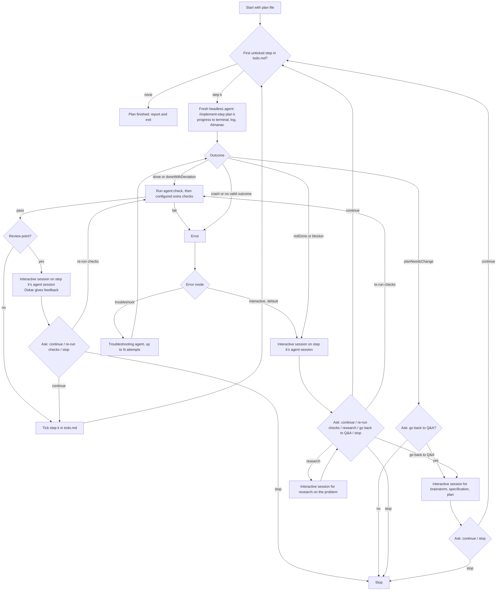

# Plan execution loop

## Problem Statement

Oskar works in a fixed chain: the brainstorm skill produces `qa.md`, the specification skill produces `spec.md`, and the plan skill produces `plan.md` with one self-contained prompt per step and `todo.md` with one checkbox per step. Today he runs each step by hand: he pastes the step prompt into a session, watches it, checks the result, ticks `todo.md`, and starts the next step. That is slow, and the steps are already written so that an agent can do them alone.

The obvious fix, an unattended loop that keeps an agent busy until "done" (the Ralph loop, a "dark factory"), does not fit. It lets the model pick the next task, lets it grade its own work, grows one context across tasks, and makes design decisions nobody approved. The research in `loop-research/findings.md` shows the same failures in practice: agents declare victory too early, a single "done" signal cannot say "blocked" or "the plan is wrong", and nobody reads the result.

The goal is a loop that takes a plan file and works through its steps the way Oskar would: one step at a time with a fresh context, following AGENTS.md, with clear progress while it runs and a clear result after each step. It stops when something is wrong, pauses for his review where he asked for it, hands over to an interactive session when a person is needed, and sends him back to Q&A when the work would diverge from the plan. It starts simple and Claude-only, but on foundations that allow adding Codex, OpenCode, review agents and other extensions piece by piece, and later moving to a reusable CLI and to Emmett workflows.

## Solution

### The pieces

There are three pieces. They share one rule: an implementation agent makes only implementation decisions within the scope of its step. Anything else goes back to Oskar.

1. **The `implement-step` skill** does one step of a plan. It can be used by hand (`/implement-step <plan file> <step number>`) in a normal interactive session, or by the loop. It reads the step's prompt from the plan, follows AGENTS.md (test-first, smallest relevant tests, no commits), writes to the plan's progress file, and ends with an outcome in a fixed format.
2. **The loop script** is a small TypeScript script next to the existing hooks in `.agents`. It takes a plan file. It decides which step runs next, starts a fresh headless agent for it, shows progress, reads the outcome, runs `agent:check` and the extra checks, ticks `todo.md`, and stops or pauses when needed. The model never picks the next step.
3. **The `run-plan` skill** is a lighter loop inside one Claude session, for simpler passes. It walks the same `todo.md` and starts a fresh subagent with the `implement-step` skill for each step, so each step still gets a fresh context. It uses the same outcomes and the same stop rules, and runs `agent:check` after each successful step, because build and lint must never be broken. It has no extra checks, no Almanac and no interactive hand-over beyond the session it runs in.

Like the existing skills, all of this is generic. It is copied into other repositories by hand for now, and may become a CLI or package later.

### One step

The `implement-step` skill works through a step like this:

- Read AGENTS.md, the plan's "Terms" and "Rules" sections, and the step's prompt.
- Read the plan's progress file. If an earlier attempt at this step left notes, continue from them.
- Do the step test-first.
- Do not make decisions outside the step's scope. If the step cannot be done as written, stop and report it.
- At the end, write to the progress file: a short summary on success, or a longer write-up on failure (what was tried, what failed, what is left, what decision is needed).
- Return the outcome.

The outcomes are:

- `done`: the step is finished as written.
- `doneWithDeviation`: finished, but with an implementation-level deviation from the prompt, which the outcome describes.
- `notDone`: not finished, for example because of a failing test the agent could not fix.
- `blocker`: something outside the step stops it, for example a missing prerequisite or a contradiction between the step and the code.
- `planNeedsChange`: the step can only be done by changing the plan or the spec, for example a decision that is not an implementation decision.

Each outcome carries a short summary. All outcomes other than `done` carry the details.

The existing Stop hook still runs `agent:check` inside the agent's session, so the agent sees a failing check while it can still fix it. The loop does not rely on that alone (see "Checks after a step").

A step is normally a full red-green cycle: the agent writes a failing test, makes it pass and refactors, so the tests are green when the step ends.

### The loop

A few rules make this predictable:

- **Next step.** The loop always takes the first unticked step in `todo.md`. A ticked step is done. After a trip back to Q&A, the plan skill has updated `plan.md` and `todo.md`, and the loop again takes the first unticked step.
- **Start resumes.** Starting the loop again continues: the first unticked step is the one that was in progress, and its fresh agent reads that step's notes in the progress file.
- **Restart.** With the restart setting, the loop unticks every step in `todo.md` and starts from the first one. It does not touch code that earlier runs changed. What restart should do with that code is a later decision.
- **Ticking.** Only the loop ticks `todo.md`, and only after the outcome was `done` or `doneWithDeviation`, `agent:check` and the extra checks passed, and a review (if this step has one) ended with "continue". The agent reports; the loop decides.
- **Errors.** An error is a crash of the agent process, a missing or invalid outcome, a failed `agent:check`, or a failed extra check that the step does not allow to fail. `notDone`, `blocker` and `planNeedsChange` are not errors: the agent reported them on purpose.
- **"Go back to Q&A".** The loop opens an interactive session in which Oskar runs the brainstorm skill on the plan's folder, then the specification and plan skills. When he exits, the loop asks whether to continue with the updated plan.
- **No commits.** The loop never commits or changes Git history. It never edits `plan.md` or `spec.md` itself.

### Checks after a step

Build and lint must never be broken. After every step that reports `done` or `doneWithDeviation`, the loop runs `agent:check` itself, before any configured extra check. This is built in and cannot be switched off. It closes a gap in the Stop hook: when the hook's first check fails, the agent fixes something and stops again with `stop_hook_active` set, and the hook skips the second check, so a headless run could end with a broken build and still report `done`.

Tests must be green after a step, unless the plan explicitly says otherwise for that step. A step can carry a "tests may be broken" mark, a single line in the step's section outside the prompt block, like the review mark. For such a step the loop still runs the configured test checks and logs their failures, but does not treat them as an error. Plans should avoid this mark. The plan skill gets a note that it is only for cases where it makes progress smoother, and only for a short stretch of steps.

### Review points

Review points come from two places, and a step is reviewed if either one says so:

- The run settings: `every` step, or a list of step numbers.
- The plan: a step can carry a review mark.

At a review point, the loop shows the step's summary and opens an interactive Claude session on the agent session of that step (Claude's `--resume`). Oskar reads the result and tells the agent what to improve. When he exits, the loop asks what to do next.

### Settings

The loop takes the plan file as its only required input. Everything else is a setting with a default:

- Restart: off. When on, untick everything and start from step 1.
- Review points: none by default. `every`, or a list of step numbers. Review marks in the plan always apply.
- Error mode: `interactive` (default) or `troubleshoot`.
- Troubleshooting: how the troubleshooting agent starts, by resuming the failed step's session (default) or fresh with the failure write-up. And how many attempts it gets before the loop falls back to the interactive mode (default 1).
- Extra checks: a list of commands the loop runs after the built-in `agent:check`, in order, from the repository's `src` folder, for example `npm run test:unit`. Empty by default.
- Permission mode for the headless agent: `bypassPermissions` by default, so that the agent does not stop on basic permission prompts that nobody can answer in a headless run. This needs further investigation (see Further Notes).
- Agent: `claude`. The only one in the first version.

### What Oskar sees

- **In the terminal, while a step runs:** live progress read from the agent's JSON event stream: the step that started, each tool call (file edits, commands run), retries, and the outcome with its summary.
- **In the run log**, one Markdown file next to `todo.md`: each run gets a heading with its start time and settings. Under it, each step gets its start, the agent's session id, the outcome with its summary or details, `agent:check` and the extra checks with their results, the review and the answers Oskar gave, and how the run ended.
- **In the progress file**, one Markdown file next to `todo.md`, written by the agent: the short summary or the longer write-up for each step.
- **In Almanac:** a span for the run, a child span for each step, and child spans for the agent run, each check (`agent:check` and the extra checks) and each interactive session, with the outcome, session id and step number as attributes. Almanac's composite tracer sends the spans both to the console and to OpenTelemetry, so the run can also be followed in a tracing backend.

### Ready for more

The first version is deliberately small, but the parts that will grow are separate from the start:

- **Agents.** Everything specific to Claude sits in one agent adapter. It knows how to start a headless run for a step, how to turn the agent's output lines into the loop's own small set of progress events, how to read the outcome, and how to open an interactive session on an earlier run. Codex (`codex exec --json`, resume by id) and OpenCode (`opencode run --format json`, `--session <id>`) are later adapters with the same shape.
- **Extra checks** are a list of commands. A later review agent, or Gojko-style gate and check roles, are more entries at the same point.
- **Observability** goes through Almanac. Later, Emmett workflows can drive the steps, with the outcomes as messages.

## Acceptance criteria

### Picking the step

1. The loop picks the next step from `todo.md`, so that the plan runs in its written order and the model never chooses.
   1.1. GIVEN a `todo.md` with steps 1 and 2 ticked and step 3 unticked WHEN the loop starts THEN it runs step 3 first.
   1.2. GIVEN a `todo.md` with every step ticked WHEN the loop starts THEN it runs no agent, reports that the plan is finished, and exits with code 0.
   1.3. GIVEN a `todo.md` where step 2 is unticked and step 4 is ticked WHEN the loop starts THEN it runs step 2.
   1.4. GIVEN a plan file whose folder has no `todo.md` WHEN the loop starts THEN it reports the missing file and exits with a non-zero code without running an agent.
   1.5. GIVEN an unticked step in `todo.md` whose number has no matching step in `plan.md` WHEN the loop reaches it THEN it reports the mismatch and stops without running an agent.
   1.6. GIVEN a plan file path that does not exist WHEN the loop starts THEN it reports it and exits with a non-zero code.

### Running a step

2. The loop runs each step in a fresh agent, so that no context leaks from one step to the next.
   2.1. GIVEN steps 1 and 2 unticked WHEN the loop runs both THEN each step runs in its own agent process with its own session id.
   2.2. GIVEN step 3 is next WHEN the loop starts its agent THEN the agent is asked to run the `implement-step` skill for the plan file and step 3.
   2.3. GIVEN a step runs WHEN the agent edits a file or runs a command THEN the terminal shows it while the step is still running.
   2.4. GIVEN a step runs WHEN the agent's run starts THEN the log records the step number and the agent's session id.

### Outcomes

3. The loop acts on the outcome the agent reports, so that "done", "blocked" and "the plan is wrong" lead to different behaviour.
   3.1. GIVEN no extra checks and no review point WHEN the agent reports `done` with a summary THEN the loop ticks the step in `todo.md`, shows and logs the summary, and starts the next step.
   3.2. GIVEN no extra checks and no review point WHEN the agent reports `doneWithDeviation` THEN the loop ticks the step, shows and logs the deviation, and starts the next step.
   3.3. GIVEN the agent reports `notDone` with details WHEN the loop reads the outcome THEN it does not tick the step, shows the details, and hands over to Oskar as for an error in the interactive mode.
   3.4. GIVEN the agent reports `blocker` with details WHEN the loop reads the outcome THEN it does not tick the step, shows the details, and hands over to Oskar as for an error in the interactive mode.
   3.5. GIVEN the agent reports `planNeedsChange` with details WHEN the loop reads the outcome THEN it does not tick the step, shows the details, and asks Oskar whether to go back to Q&A.
   3.6. GIVEN the agent process exits without a valid outcome WHEN the loop reads its output THEN it treats this as an error and does not tick the step.
   3.7. GIVEN the agent process exits with a non-zero code WHEN the loop reads its output THEN it treats this as an error and does not tick the step.
   3.8. GIVEN steps 1 to 3 unticked WHEN step 1 reports `done` and step 2 reports `blocker` THEN step 1 is ticked, step 2 is not, and step 3 has not run.

### Extra checks

4. The loop runs extra checks after the agent reports success, so that the agent does not grade its own work alone.
   4.1. GIVEN extra checks `npm run test:unit` configured WHEN the agent reports `done` THEN the loop runs `agent:check` and then `npm run test:unit` from `src` before it ticks the step.
   4.2. GIVEN two extra checks WHEN the first one fails THEN the loop does not run the second, does not tick the step, and treats the failure as an error.
   4.3. GIVEN an extra check fails WHEN the loop reports it THEN the terminal and the log show which check failed, its exit code and its output.
   4.4. GIVEN extra checks configured WHEN the agent reports `notDone`, `blocker` or `planNeedsChange` THEN the loop runs no extra check.
   4.5. GIVEN no extra checks configured WHEN the agent reports `done` and `agent:check` passes THEN the loop ticks the step.
   4.6. GIVEN the agent reports `done` WHEN the loop's own `agent:check` fails THEN the loop does not tick the step, runs no extra check, and treats the failure as an error.
   4.7. GIVEN the hook's first `agent:check` failed in the agent's session and the agent stopped again without a second check WHEN the agent reports `done` THEN the loop's own `agent:check` still runs and decides.
   4.8. GIVEN a step with the "tests may be broken" mark and `npm run test:unit` configured WHEN the tests fail THEN the loop logs the failures, does not treat them as an error, and ticks the step.
   4.9. GIVEN a step with the "tests may be broken" mark WHEN `agent:check` fails THEN the loop treats it as an error, because build and lint must never be broken.
   4.10. GIVEN a step without the "tests may be broken" mark WHEN a configured test check fails THEN the loop treats it as an error.

### Review points

5. The loop pauses for Oskar's review where he asked for it, so that he can give feedback before the plan goes on.
   5.1. GIVEN review points set to `every` WHEN a step's outcome is `done` and its checks pass THEN the loop shows the summary and opens an interactive session on that step's agent session before it ticks the step.
   5.2. GIVEN review points set to steps 3 and 8 WHEN steps 2 and 3 succeed THEN the loop pauses after step 3 only.
   5.3. GIVEN no review points in the settings and a review mark on step 4 in the plan WHEN step 4 succeeds THEN the loop pauses after step 4.
   5.4. GIVEN review points set to step 2 and a review mark on step 4 WHEN steps 2 to 4 succeed THEN the loop pauses after step 2 and after step 4.
   5.5. GIVEN a review session WHEN Oskar exits it and answers "continue" THEN the loop ticks the step and starts the next one.
   5.6. GIVEN a review session WHEN Oskar exits it and answers "re-run checks" THEN the loop runs the extra checks again and, if they pass, asks again.
   5.7. GIVEN a review session WHEN Oskar exits it and answers "stop" THEN the loop does not tick the step, logs the stop, and exits.
   5.8. GIVEN a review WHEN it ends THEN the log records that the step was reviewed and Oskar's answer.

### Errors

6. On an error the loop either hands over to Oskar or lets an agent troubleshoot, as the setting says, so that a failure never passes silently.
   6.1. GIVEN the default error mode WHEN a step ends in an error THEN the loop shows the error and opens an interactive session on that step's agent session.
   6.2. GIVEN the interactive error session WHEN Oskar exits and answers "continue" THEN the loop goes back to the first unticked step, which is the same step if he did not tick it.
   6.3. GIVEN the interactive error session WHEN Oskar exits and answers "re-run checks" THEN the loop runs the extra checks and, if they pass, ticks the step and continues.
   6.4. GIVEN the interactive error session WHEN Oskar exits and answers "go back to Q&A" THEN the loop follows the Q&A path.
   6.5. GIVEN the interactive error session WHEN Oskar exits and answers "research" THEN the loop opens an interactive session for research on the step's problem and asks again when he exits.
   6.6. GIVEN the interactive error session WHEN Oskar exits and answers "stop" THEN the loop logs the stop and exits with a non-zero code.
   6.7. GIVEN the error mode `troubleshoot` with resume and 1 attempt WHEN a step ends in an error THEN the loop resumes the failed step's agent session with the error details and reads its new outcome.
   6.8. GIVEN the error mode `troubleshoot` with fresh start WHEN a step ends in an error THEN the loop starts a new agent with the failure write-up and reads its new outcome.
   6.9. GIVEN the error mode `troubleshoot` with 2 attempts WHEN both attempts end in an error THEN the loop falls back to the interactive error session.
   6.10. GIVEN the error mode `troubleshoot` WHEN the troubleshooting agent reports `done` and the checks pass THEN the loop ticks the step and continues.
   6.11. GIVEN any error WHEN the loop reports it THEN the terminal and the log show the step, the kind of error and the agent's session id.

### Going back to Q&A

7. When the work would diverge from the plan, the loop stops and asks whether to go back to Q&A, so that spec and plan stay the source of truth.
   7.1. GIVEN the agent reports `planNeedsChange` WHEN Oskar answers "no" to going back to Q&A THEN the loop logs the stop and exits without ticking the step.
   7.2. GIVEN the agent reports `planNeedsChange` WHEN Oskar answers "yes" THEN the loop opens an interactive session for the brainstorm skill on the plan's folder.
   7.3. GIVEN the Q&A session WHEN Oskar has updated `plan.md` and `todo.md` and exits and answers "continue" THEN the loop reads `todo.md` again and starts the first unticked step.
   7.4. GIVEN the Q&A session changed the plan WHEN the loop continues THEN steps still ticked in `todo.md` are not run again.
   7.5. GIVEN the Q&A session WHEN Oskar exits and answers "stop" THEN the loop logs the stop and exits.

### Resume and restart

8. Starting the loop again continues where it stopped, and a restart setting starts over, so that a stop never loses work.
   8.1. GIVEN a run stopped during step 5 WHEN the loop starts again without restart THEN it runs step 5 with a fresh agent.
   8.2. GIVEN step 5 left notes in the progress file WHEN step 5 runs again THEN its agent is asked to continue from those notes.
   8.3. GIVEN a run stopped WHEN the loop starts again THEN the log keeps the earlier run and adds a new run heading.
   8.4. GIVEN steps 1 to 4 ticked WHEN the loop starts with restart THEN it unticks every step in `todo.md` and runs step 1.
   8.5. GIVEN a restart WHEN the loop starts THEN the log records that the run is a restart.
   8.6. GIVEN a restart WHEN the loop starts THEN no file other than `todo.md` and the log is changed by the loop.

### The step skill on its own

9. Oskar can run one step by hand with the `implement-step` skill, so that the loop and manual work share one definition of a step.
   9.1. GIVEN an interactive session WHEN Oskar runs `/implement-step <plan file> 3` THEN the agent reads step 3's prompt and works on it test-first.
   9.2. GIVEN a step succeeds WHEN the skill ends THEN the progress file has a short summary for the step and the skill returns `done` or `doneWithDeviation`.
   9.3. GIVEN a step fails WHEN the skill ends THEN the progress file has a longer write-up for the step with what was tried, what failed and what is left.
   9.4. GIVEN a step needs a decision outside its scope WHEN the agent finds it THEN it stops, does not make the decision, and returns `planNeedsChange` or `blocker` with the question.
   9.5. GIVEN the skill runs by hand WHEN it ends THEN it does not tick `todo.md` and does not commit.
   9.6. GIVEN a plan whose step number does not exist WHEN the skill is run for it THEN it reports that and returns `blocker`.

### The in-session loop skill

10. Oskar can run a simpler pass inside one session with the `run-plan` skill, so that small plans do not need the script.
    10.1. GIVEN a plan with two unticked steps WHEN Oskar runs `/run-plan <plan file>` THEN each step runs in a fresh subagent with the `implement-step` skill.
    10.2. GIVEN a subagent reports `done` AND `agent:check` passes WHEN the skill reads it THEN it ticks the step and starts the next one.
    10.3. GIVEN a subagent reports anything other than `done` or `doneWithDeviation` WHEN the skill reads it THEN it stops, shows the details, and asks Oskar what to do.
    10.4. GIVEN a subagent reports `planNeedsChange` WHEN the skill reads it THEN it asks whether to go back to Q&A.
    10.5. GIVEN a subagent reports `done` WHEN `agent:check` fails afterwards THEN the skill does not tick the step, stops, and shows the failure.

### Progress and observability

11. The loop makes each run observable, so that Oskar can see what happened during and after it.
    11.1. GIVEN a run WHEN it starts THEN the log gets a run heading with the start time and the settings in effect.
    11.2. GIVEN a step ends WHEN the loop records it THEN the log has the step number, session id, outcome, summary or details, and each check with its result.
    11.3. GIVEN a run WHEN it ends, for any reason THEN the terminal and the log state how it ended: plan finished, stopped by Oskar, or stopped on a step with its reason.
    11.4. GIVEN a run WHEN it executes THEN Almanac records a run span with one child span per step, and under each step spans for the agent run, each extra check and each interactive session.
    11.5. GIVEN a step span WHEN the step ends THEN the span has the step number, session id and outcome as attributes.
    11.6. GIVEN the console and OpenTelemetry tracers configured WHEN a run executes THEN both receive the same spans.

### Boundaries

12. The loop stays inside Oskar's rules, so that it never does what AGENTS.md forbids.
    12.1. GIVEN any run WHEN it ends THEN the loop has created no commit, branch or tag.
    12.2. GIVEN any run WHEN it ends THEN the loop has not changed `plan.md` or `spec.md` itself.
    12.3. GIVEN a headless agent run WHEN the agent finishes THEN the project's Stop hook has run `agent:check` as in an interactive session.
   12.4. GIVEN a headless agent run with default settings WHEN the agent edits files and runs commands THEN it is not stopped by a permission prompt.

## Implementation Decisions

- **Three modules.** The loop script, the `implement-step` skill and the `run-plan` skill. The skills follow the existing layout: the body in the shared skills folder, with thin pointers for Claude Code and OpenCode, as `.agents/README.md` describes. The script sits next to the existing hooks in `.agents` and runs with Node from `src`, like the hooks.
- **Generic.** Nothing in the three modules depends on Emmett. Commands that differ per repository (where checks run, which checks) are settings. The modules can be copied into another repository by hand.
- **Module pattern.** Functions, closures and object literals, no classes, as AGENTS.md says.
- **Processes through execa.** The script uses execa to start the agent and the checks: line-by-line streaming of stdout, the exit code on the error, and `stdio: 'inherit'` (plain, not mixed) for interactive sessions so that the child gets a real terminal. This adds the first dependency to `.agents`.
- **Claude headless run.** `claude -p` with stream-json output, so that progress can be shown live, and a JSON schema for the final outcome, so that the outcome is read from structured output, not from text. The run does not use `--bare`, so the project's hooks, CLAUDE.md and skills load. The step's prompt invokes the `implement-step` skill with the plan file and step number.
- **Interactive hand-over.** `claude --resume <session id>` on the step's session, started with the inherited terminal. The loop waits until the session ends and then asks its question in the terminal. Interactive `--continue` is not used, because it skips headless sessions.
- **Q&A hand-over.** An interactive Claude session that starts with the brainstorm skill on the plan's folder. Oskar runs the specification and plan skills himself in the same session.
- **Outcome contract.** The outcome is a small JSON object: `outcome` (one of `done`, `doneWithDeviation`, `notDone`, `blocker`, `planNeedsChange`), `summary`, and `details` for anything other than `done`. The `implement-step` skill defines it, and the loop validates it. The same contract is used by `run-plan` and by hand.
- **Agent adapter.** All Claude-specific code is behind one adapter object with four operations: start a headless step run, turn an output line into a loop progress event (session started, tool call, text, retry, result, error), read the outcome from the result, and start an interactive session on a given session id. The loop knows only the adapter and its events. Codex and OpenCode are later adapters.
- **State lives in files.** `todo.md` is the only source of which steps are done. The run log and the progress file are Markdown files next to `todo.md`. The loop keeps no other state, so a stop at any moment loses nothing and a start always resumes.
- **Marks in the plan.** A step in `plan.md` can carry a review mark and a "tests may be broken" mark, each a single line in the step's section outside the prompt block. The plan skill gets a short note on how to add them, and says that a step is normally a full red-green cycle and that the "tests may be broken" mark is to be avoided, used only to make progress smoother and only for a short stretch of steps.
- **Built-in check.** `agent:check` runs after every successful step as a fixed first check, not as a setting. The hook is not changed.
- **Permission mode.** The headless run gets `bypassPermissions` by default, as a setting.
- **Terminal questions.** The loop asks its questions (continue, re-run checks, research, go back to Q&A, stop) on the terminal with a fixed set of answers.
- **Observability.** The loop uses Almanac's tracer, with the console and OpenTelemetry tracers joined by the composite tracer. One run span, step spans under it, and spans for agent runs, checks and interactive sessions under each step.
- **Defaults to revisit.** These were set to the simplest choice when Q&A stopped (Q22, Q23) and should be revisited after the first version works: the loop asks in the terminal after every interactive session, instead of reading an outcome written in the session; the number of troubleshooting attempts is a setting with default 1; the agent writes one progress file per plan; and an error means a crash, a missing outcome or a failed check.

## Testing Decisions

- **What a good test is.** Tests check what Oskar can observe: the exit code, the terminal output, the log, the progress file and the ticks in `todo.md`. They do not check internal functions or call order. Test names describe the behaviour from the usage side, as AGENTS.md says.
- **Main seam: the loop script as a process.** Integration specs create a temporary Git repository with a `plan.md` and a `todo.md`, run the loop with Node, and check the observable results. This is how the existing hook specs in `.agents/hooks` test the hooks. Almost every acceptance criterion is tested here.
- **A stand-in agent at the process boundary.** The agent command is a setting. In integration specs it points to a small script that prints Claude-shaped stream-json lines and a chosen outcome, and for interactive sessions reads the answer from stdin. The loop's code is the same as in real use. This follows the fake `agent:check` script in `validate-change.int.spec.ts`. The temporary repository gets the same kind of fake `agent:check` script, so the built-in check can pass or fail on demand. Oskar accepted this seam when he approved the design.
- **End-to-end with real Claude.** A few specs run the loop with real Claude on a tiny two-step plan in a temporary repository: the happy path, a review hand-over, and a `planNeedsChange` stop. They are slow and cost money, so they run in the end-to-end suite, not in the unit and integration suites.
- **Unit specs** cover only small pure parts where the process seam is clumsy: finding the next step in `todo.md`, reading review marks from the plan, validating the outcome, and turning Claude's output lines into progress events.
- **Observability** is checked with Almanac's testing helpers in the integration specs: span names, nesting and attributes.
- **Skills** have no automated tests of their own. The end-to-end specs exercise `implement-step` through the loop. `run-plan` is checked by hand on a small plan.
- **Where the specs run.** The `agents` Vitest project in `src`, which already includes the hook specs.

## Out of Scope

- Codex and OpenCode adapters. The adapter shape is in place; the adapters are later work.
- A review agent, Gojko-style gate and check roles, or any other extra step beyond configured commands.
- Running steps in parallel or in dependency groups.
- Committing, branching or any Git history change.
- What restart does with code that earlier steps already changed.
- Reading the outcome of an interactive session from the session itself instead of asking in the terminal.
- Detecting divergence automatically (for example from changed files). The agent reports it.
- Limits on turns, budget or wall time.
- A published CLI or npm package, and running the loop as an Emmett workflow.
- Changes to the hooks, beyond what the loop needs to work with them as they are.

## Further Notes

- Decisions and their reasons are in `qa.md` in this folder, with Oskar's answers quoted. The research is in `loop-research/` (`findings.md`, `sources.md`).
- The closest prior art is Gojko Adzic's lights-on software factory: a deterministic orchestrator, a worker that reports a structured outcome including deviations and blockers, and a script that records progress instead of the agent. This spec borrows those ideas but stays smaller and keeps Oskar's existing brainstorm, specification and plan skills as the planning side.
- Matt Pocock's advice applies to how the loop is adopted: run it with a review point on every step first, and widen the gaps only once the results are trusted.
- Permissions need further investigation in the next steps. `bypassPermissions` was chosen so that the agent never stops on basic permission prompts, but it lets the agent run any command. A narrower setup, such as `acceptEdits` with an allow-list of commands, or Gojko-style regulator hooks, should be checked once the first version works. Project settings today allow only `npm run build:ts:*`, `npm run test:file:*` and one WebFetch domain.
- The `implement-step` skill must say that the agent may not ask Oskar questions mid-step in a headless run. It stops and reports instead.
